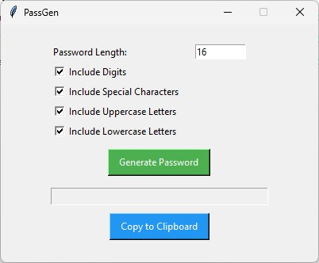

# PassGen - a simple Python password generator


## About the project
This is a project that I made in my first year at the Transylvania University of Brasov for
a subject called Computer Programming and Programming Languages II. The project uses `tkinter` for
the GUI and the `secrets` module for generating the passwords. <br><br>
**Disclaimer:** The password generator shouldn't be used for generating personal passwords.

## Running the project
Make sure that you have Python installed:
```
python --version
```

Then, clone the repository:

```
git clone https://github.com/mihaiturcanu/PassGen
```

Navigate to `code/` and run the `main.py` file:
```
python main.py
```